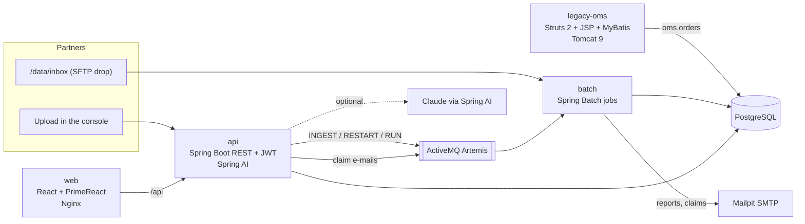

# ReconHub

Multi-channel payment reconciliation for online sellers. ReconHub loads settlement files from
carriers (GHN, GHTK), marketplaces (Shopee, TikTok Shop), a bank (Vietcombank) and an e-wallet (MoMo),
matches every money line against the orders in the shop's order system (OMS), and sends what the rules
cannot match to an exception queue. Accountants resolve exceptions with AI suggestions; large write-offs
need the chief accountant's approval.



## Run it with Docker

Requirements: Docker with Compose v2, about 4 GB of free memory.

```bash
git clone https://github.com/Happy-Creative-LLC/ReconHub.git
cd ReconHub
cp .env.example .env            # optional: set ANTHROPIC_API_KEY to turn on the LLM
docker compose up -d --build
docker compose logs -f batch    # first start: wait for "Demo history: ... handled"
```

The first start takes 3 to 6 minutes: images build, the data generator writes 30 days of sample
orders and partner files, and the batch app replays them day by day (about one minute).

| URL | What | Login |
|---|---|---|
| http://localhost:8080 | ReconHub console | `ha`, `khoa` (accountants), `nam` (chief accountant), `bao` (admin), password `demo123` |
| http://localhost:8088/oms/ | Legacy OMS | `sale` / `sale123` |
| http://localhost:8025 | Mailpit: report and claim e-mails | |
| http://localhost:8161 | Artemis console | `artemis` / `artemis` |

Ports and passwords can be changed in `.env`. `docker compose down -v` removes everything, including the data.

### Things to try

1. **Overview**: auto-match rate, unreconciled money by partner, late partner files, failed jobs that still need someone
   (not restarted, not replaced by a later file, not marked as handled).
2. **Exception queue → an "unmatched payment"**: the AI suggestion ranks candidate orders with reasons; confirm it to match.
3. **Maker-checker**: as `ha`, request a write-off above 50,000 ₫; it waits for approval. Sign in as `nam` to approve
   (the requester cannot approve their own request).
4. **Batch monitor → the failed `fileIngestionJob`**: GHTK changed its date format, so the job stopped the file instead of
   silently skipping most of its rows. "AI giải thích" explains it, and points to the corrected `_v2` file loaded later the same day.
   Because that replacement loaded, the run shows "Đã có file thay thế …", the Overview no longer warns about it and
   "Chạy lại" is refused (it would load the day's money twice). Any other failed run can be closed with
   "Đánh dấu đã xử lý" and a required note; the expanded row shows who did it and when.
5. **Restart a job**: `docker compose stop mailpit`, press "Chạy ngay" on `agingAndReportJob`, it fails at
   `emailReportStep`. `docker compose start mailpit`, press "Chạy lại": only the e-mail step runs again.
6. **Cross-system flow**: create an order in the legacy OMS (pay via VCB), then upload a Vietcombank statement whose
   description contains the order code (see [docs/runbook.md](docs/runbook.md#upload-a-bank-statement-for-a-new-order)).
   The line is matched automatically and the OMS order page shows "Đã khớp".
7. **Data assistant**: "GHN còn nợ mình bao nhiêu?", "Có bao nhiêu ngoại lệ quá hạn?". The admin account gets no amounts.

## AI

AI runs through **Spring AI** (`spring-ai-starter-model-anthropic` 1.1.8) with model `claude-opus-5-5`.
Without `ANTHROPIC_API_KEY` every AI feature still works on built-in rules; the top bar shows which one is active.

| Feature | Rules (always) | LLM (with a key) |
|---|---|---|
| Exception suggestion | Candidate orders scored on amount, code similarity, customer name, time | Re-ranks candidates and writes the summary; structured output (`responseEntity`) |
| Mapping for a new partner file | Header synonyms + sample-value checks | Proposes the mapping with notes for a person to check |
| Batch failure explanation | Patterns for skip limits, date formats, SMTP, missing files | Cause and steps from the execution metadata |
| Data assistant | Keyword routing to six read-only tools | Tool calling with the same six read-only tools (`@Tool`), filtered by role |

Guardrails: the LLM never writes to the database or picks a match by itself (a person confirms); customer names and
phone numbers are masked before anything is sent; each user has a daily request limit and every call is logged in
`ai_requests`. The chat model is built without `temperature`/`top_p`/`top_k`, which this model rejects, and any API
error or refusal falls back to the rule result.

## Repository layout

| Path | What it is |
|---|---|
| `server/core` | Domain, JPA entities, Flyway migrations, MyBatis report SQL, matching engine, workflow, Spring AI services |
| `server/api` | REST API: JWT login, exception workflow, file upload, reports, batch monitor, AI endpoints |
| `server/batch` | Spring Batch jobs, inbox poller, schedules, JMS listeners, demo backfill |
| `web` | React 19 + PrimeReact console; runs on sample data (`npm run dev`) or the API (`npm run dev:http`) |
| `legacy-oms` | The shop's old order system: Struts 6, JSP, MyBatis, JNDI pool on Tomcat 9 |
| `tools/datagen` | Sample data generator with ground truth, and `eval_matching.py` (precision of automatic matching) |
| `docs` | [Architecture](docs/architecture.md), [runbook](docs/runbook.md), [roadmap](docs/roadmap.md), [Claude Code prompts](docs/claude-code-prompts.md) |
| `scripts/verify.sh` | Builds and tests every module inside Docker (no local JDK or Node needed) |
| `CLAUDE.md` | Project rules for Claude Code |

## Development

```bash
# Infrastructure only, then run the apps from the IDE or the command line
docker compose up -d postgres artemis mailpit
python3 tools/datagen/generate.py --out ./data            # pip install -r tools/datagen/requirements.txt
cd server && mvn -q package -DskipTests
DATA_DIR=../data java -jar batch/target/reconhub-batch.jar  # port 8081
DATA_DIR=../data java -jar api/target/reconhub-api.jar      # port 8080

cd web && npm install
npm run dev        # sample data, no backend (http://localhost:5173)
npm run dev:http   # real API, proxied to localhost:8080
```

Tests: `mvn -f server/pom.xml verify` runs unit tests and Testcontainers integration tests (Docker required):
matching rules, maker-checker and optimistic locking, the late-payout auto-close, file ingestion with skipped rows,
a failed file, checksum de-duplication, and the API's login and role rules. CI also starts the whole stack and fails
if any automatic match disagrees with the generator's ground truth.

## API

All endpoints except login need `Authorization: Bearer <token>`. Errors are `{"message": "..."}` in Vietnamese.

| Endpoint | Purpose |
|---|---|
| `POST /api/auth/login`, `GET /api/me` | Sign in (JWT, 10 h), current user |
| `GET /api/meta` | Users, sources, schedule, accounts, thresholds, AI status, server time |
| `GET /api/dashboard` | Overview screen in one call |
| `GET /api/exceptions?tab=&type=&source=&assignee=&overdue=&q=`, `GET /api/exceptions/counts`, `GET /api/exceptions/{id}` | Queue and detail |
| `POST /api/exceptions/assign` | Assign to an accountant |
| `POST /api/exceptions/{id}/match` · `/write-off` · `/write-off/decision` · `/claim` · `/duplicate` · `/comments` · `/suggestion` | Actions; bodies carry `version` (optimistic locking) |
| `GET /api/orders?q=` | OMS order search for manual matching |
| `GET /api/files`, `GET /api/files/{id}/errors`, `POST /api/files` (multipart `file`, `source`) | File intake |
| `GET /api/sources`, `POST /api/sources/{code}/mapping/suggest`, `PUT /api/sources/{code}/mapping` | Column mapping (save: admin or chief accountant) |
| `GET /api/recon/days?from=&to=&source=`, `GET /api/recon/days/{date}/{source}/groups` | Reconciliation results |
| `GET /api/aging`, `GET /api/journal?month=yyyy-MM` | Receivables aging, journal entries (112/131/641/711/811) |
| `GET /api/batch/executions`, `POST /api/batch/executions/{id}/restart`, `POST /api/batch/jobs/{job}/run` | Batch monitor and commands; failed runs carry `supersededBy` and `acknowledged` |
| `POST /api/batch/executions/{id}/acknowledge` `{"note": "..."}` | Mark a failed or stopped run as handled (any role, note required, once) |
| `POST /api/ai/batch/{id}/explain`, `POST /api/ai/ask` | Failure explanation, data assistant |
